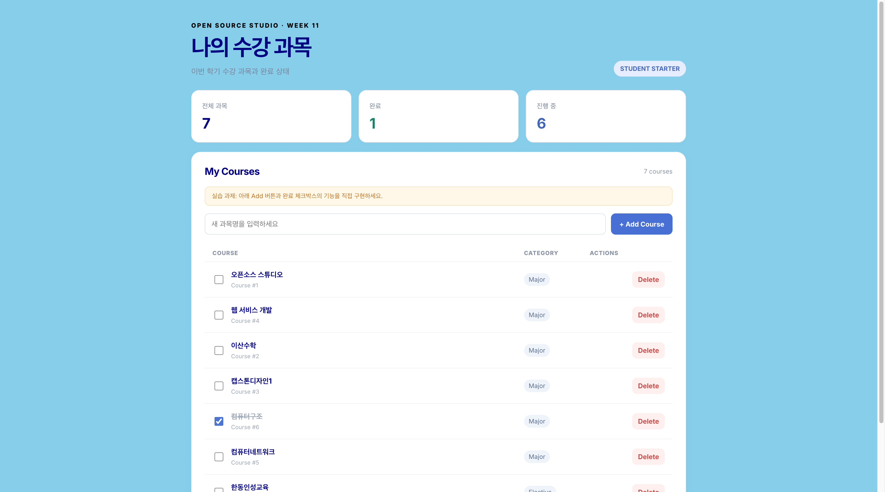

## 수행 내용

1. 코드를 실행하고 목록 조회·삭제를 확인합니다.
2. 초기 과목 5개 이상, 제목, CSS 3곳 이상 변경합니다.
3. CourseList.jsx의 **TODO 1**: 과목 등록 (빈 값 입력 방지, 고유 id 지정, State 업데이트).
4. CourseList.jsx의 **TODO 2**: 완료 체크박스 클릭 시 completed 상태 변경.
5. 선택: 검색/필터, 이름 수정 기능 추가.
6. GitHub에 Commit/Push 후 Vercel에 배포합니다.
7. README에 프로젝트 소개, 주요 코드 분석 2개, 변경 내용, Weekly Review, GitHub URL, Vercel URL을 정리합니다.

## 확인할 질문

- CourseList와 CourseItem의 역할은?: CourseList는 전체 목록과 상태를 관리하고, CourseItem은 과목 하나를 화면에 보여 준다.
- 왜 courses를 직접 수정하지 않고 setCourses()를 사용할까요?: 새 목록을 setCourses에 넘기면 React가 그 목록을 기억하고 화면을 다시 그린다.
- map()과 filter()는 각각 어떤 목적인가요?: map은 항목마다 돌려준 값을 모아 새 배열을 만든다. filter는 조건에 맞는 항목만 남긴다.
- course, onDelete, onToggle Props는 어디에서 전달되나요?: 부모인 CourseList가 CourseItem에 전달한다.
- 브라우저 새로고침 시 데이터가 초기화되는 이유는? (DB/localStorage 없음): 과목 변경은 화면이 열려 있는 동안만 기억한다. 새로고침하면 initialCourses부터 다시 시작한다.

> 교육 목적의 로컬 State 앱입니다. 서버 API 및 데이터베이스는 사용하지 않습니다.

## Project Structure: 주요 파일 3개의 역할
- App.jsx: 페이지 전체 레이아웃
- CourseList.jsx: State 및 목록, 삭제 로직
- CourseItem.jsx: Props로 데이터를 받고 이벤트 콜백 호출
- courses.js: 초기 과목 데이터
- App.css: 전체 디자인

## Component & Props: CourseList와 CourseItem의 관계 및 Props 전달 방식

CourseList가 과목마다 CourseItem을 만들고, 과목 정보와 삭제·완료 처리 함수를 넘긴다. 체크박스를 누르면 CourseItem이 자기 과목의 ID를 onToggle에 넘긴다.

## State & Event: useState를 이용한 상태 관리 및 삭제 버튼의 동작 원리

useState(initialCourses)에서 현재 목록 courses와 다음 목록을 전달할 함수 setCourses를 받는다. 삭제를 확인하면 클릭한 과목의 ID를 받아 filter로 그 과목을 제외한 배열을 만들어서 삭제한다.

## Code Analysis: 주요 코드 2개(각 5~15줄)를 선택하여 동작 원리 설명

### 과목 추가

입력한 이름과 다음 번호를 새 과목에 넣는다. 기존 목록 끝에 새 과목을 붙인 뒤 번호를 하나 올리고 입력칸을 비운다.

function handleAdd(event) {
    event.preventDefault();
    if (newName === "") return;

    const newCourse = {
    id: nextId,
    name: newName,
    category: "Elective",
    completed: false,
    };

    setCourses((previous) => [...previous, newCourse]);
    setNextId(nextId + 1);
    setNewName("");
}

### 완료 상태 변경

map으로 과목을 하나씩 확인한다. 클릭한 ID가 같으면 과목 정보를 복사하고 completed만 뒤집는다. 새 목록으로 화면을 그리면 체크 표시와 완료 개수가 바뀐다.

function handleToggle(id) {
    setCourses((previous) =>
    previous.map((course) => {
        if (course.id === id) {
        return { ...course, completed: !course.completed };
        }

        return course;
    }),
    );
}

## 프로젝트 소개 및 실행

이번 학기 수강 과목과 완료 상태를 확인하는 앱이다.

원본 Sample Project URL: https://github.com/2026-2-OSS/week11_sample_project

git clone https://github.com/2026-2-OSS/assign11-c02-22100722.git
cd assign11-c02-22100722
npm install
npm run dev

## 변경 내용
- courses.js에서 초기 목록을 이번 학기 내 수강 과목 7개로 바꿨다.
- App.jsx에서 제목을 나의 수강 과목 으로 바꾸고 설명을 수정했다.
- App.css에서 배경은 하늘색, 기본 글자는 남색, 상단 문구는 검정으로 바꿨다. 목록 테두리를 점선으로 바꿨다.
- CourseList.jsx에 과목 추가와 완료 상태 변경을 구현했다.

## Weekly Review

- useState의 첫 번째 값은 현재 상태, 두 번째 값은 함수라는 것을 배웠다.
- fillter를 통해서 삭제 기능을 구현할 수 있다는 것을 배웠다.
- 부모, 자식 간의 데이터 전송 방식을 배웠다.

처음에 setCourses가 헷갈렸는데 AI가 생성해준 값과 함수를 배열에 담아 돌려주는 예제를 보고 두 번째 칸의 함수를 받아 쓰는 흐름을 이해했다.

## 링크

GitHub URL: https://github.com/2026-2-OSS/assign11-c02-22100722
Vercel URL: https://week11-sample-project-nine.vercel.app/
